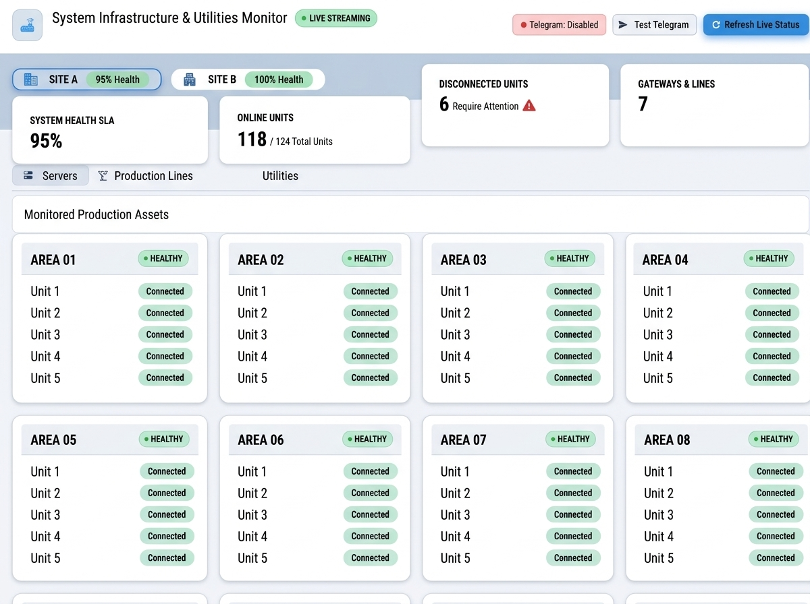
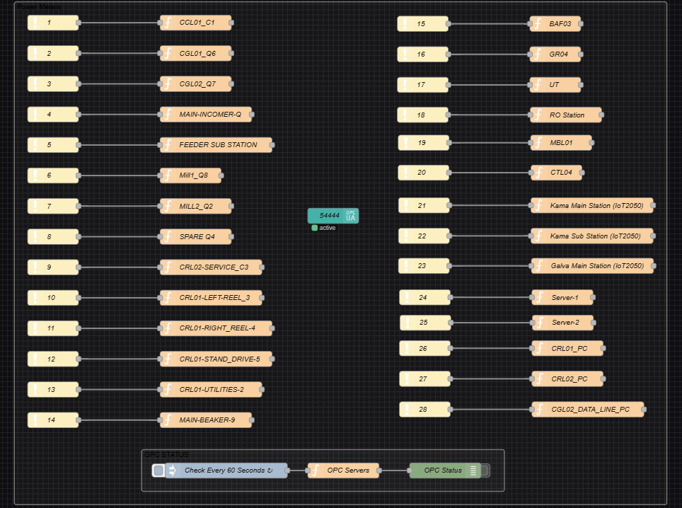

# IIoT Infrastructure & OPC UA Health Diagnostics (Node-RED)

## 📌 Overview
This Node-RED flow monitors the operational health and network reachability of industrial telemetry assets and servers to feed a live **Infrastructure Status** view in our **Insights** web portal. It pairs network reachability checks (ping) across meters, edge gateways, and servers with dedicated **OPC UA** health monitoring (including WinCC / OPC UA endpoints) on a scheduled polling interval.

## 📊 Live Visualization & Dashboard

*To give the factory and web teams immediate visibility, I integrated the diagnostics payloads directly into our "Insights" web portal. This screen shows a centralized "System Infrastructure & Utilities Monitor" using real-time telemetry from production lines, servers, and gateway systems, making it simple to pinpoint any connected or offline resources at a glance.*

## 🏗️ Architecture & Monitoring Scope

The flow is organized into two main monitoring areas:
* **Asset & Server Reachability (Ping + Function Mapping):** Periodic reachability checks across power/utility meters, production line PCs/controllers, servers, and **SIMATIC IOT2050** edge gateways, each paired with a JavaScript function node to format asset status and metadata.
* **OPC UA Health Monitoring (`OPC STATUS`):** Triggered on a recurring interval (e.g., every 60 seconds) to evaluate OPC UA server/endpoint status and format unified health states for the web infrastructure screen.

## ⚙️ Key Engineering Details
* **Unified Asset & Gateway Visibility:** Covers field meters, line PCs, central servers, and edge gateways (such as SIMATIC IOT2050 nodes) in one centralized diagnostics view so operators and engineers can quickly spot whether a dropout is caused by a device, an edge gateway, or a server.
* **Dedicated OPC UA Status Tracking:** Separates raw network ping checks from **OPC UA** status evaluation, helping distinguish between a host that responds to ping and an OPC UA service/session that is down or degraded.
* **Insights Infrastructure Feed:** Normalizes device and OPC UA statuses into consistent health states consumed by the Insights infrastructure dashboard.

## 🛠️ Tech Stack
* **Edge & Integration Runtime:** Node-RED, JavaScript (`function` nodes)
* **Industrial & Edge Targets:** OPC UA, WinCC, SIMATIC IOT2050, Plant Meters & Servers
* **Visualization:** Insights Infrastructure Dashboard
